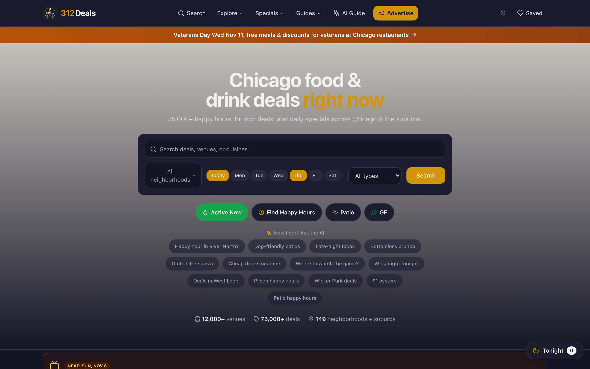
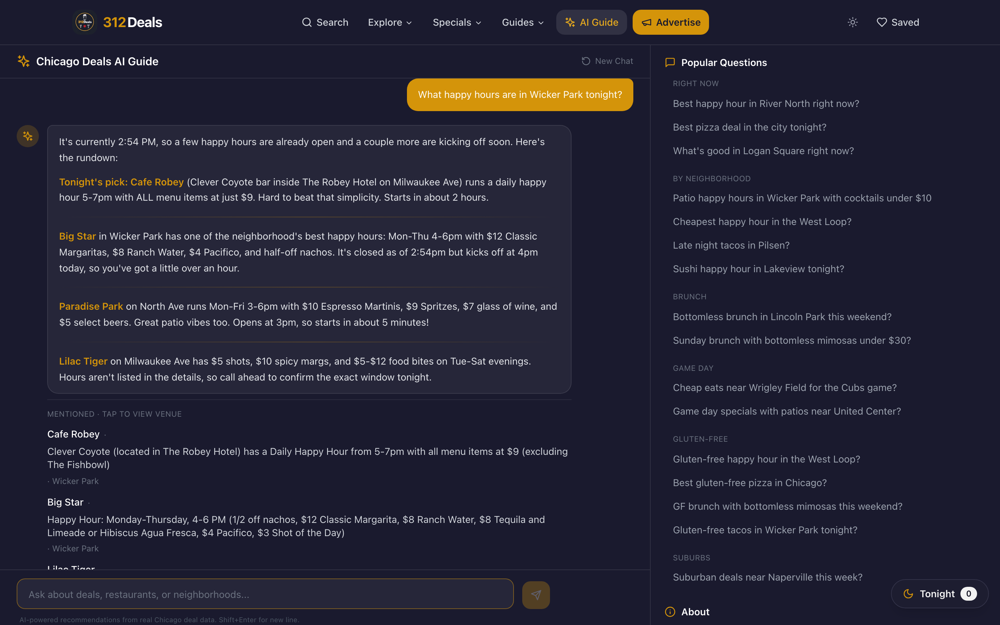
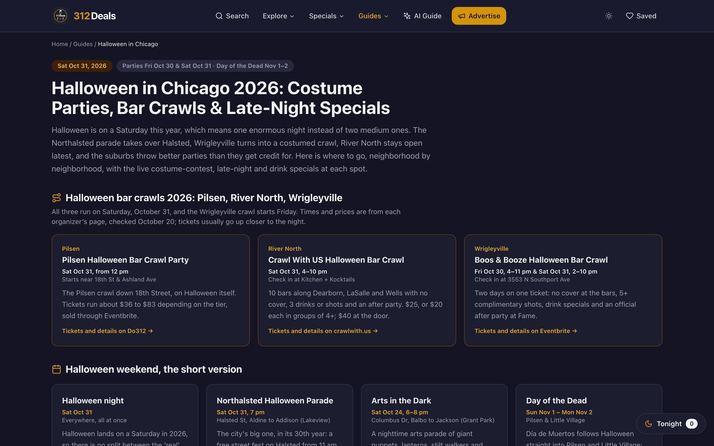
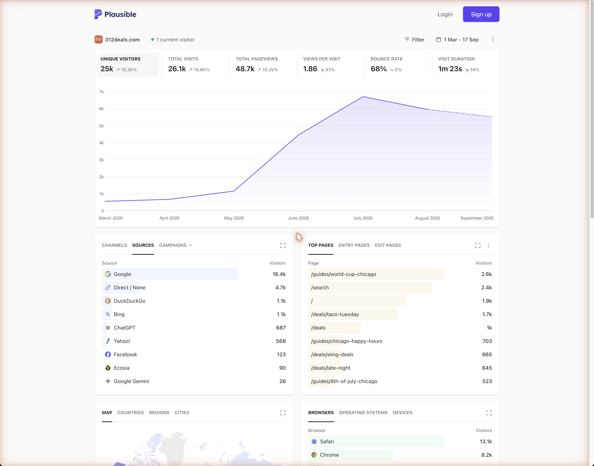
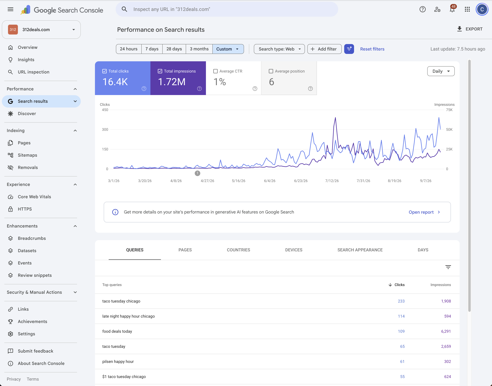
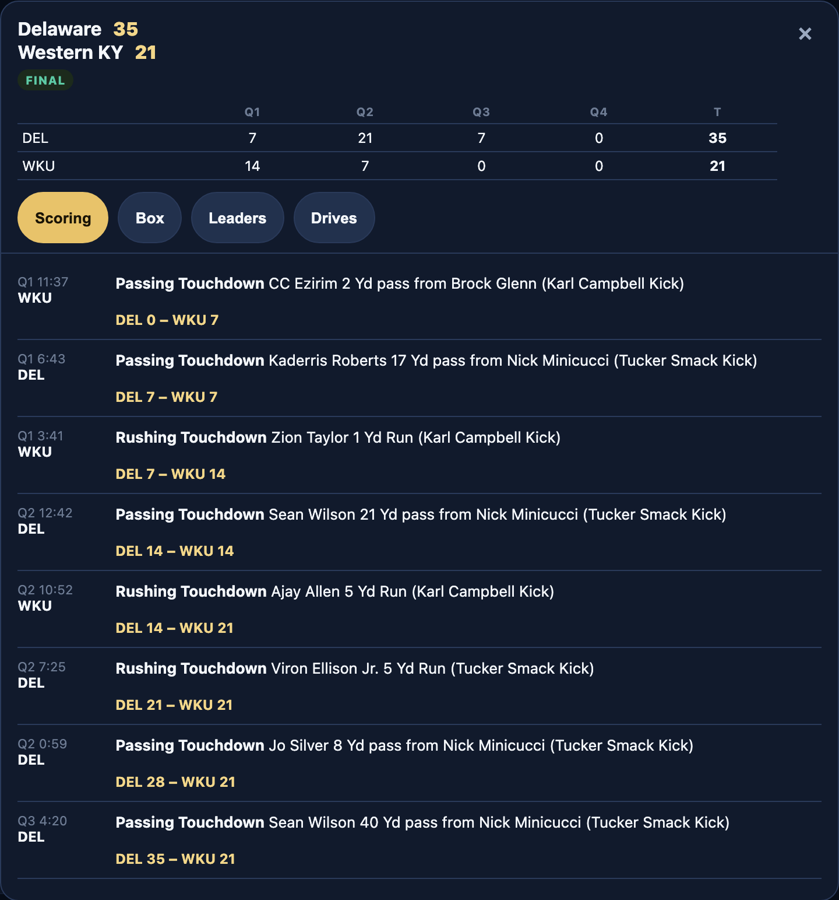
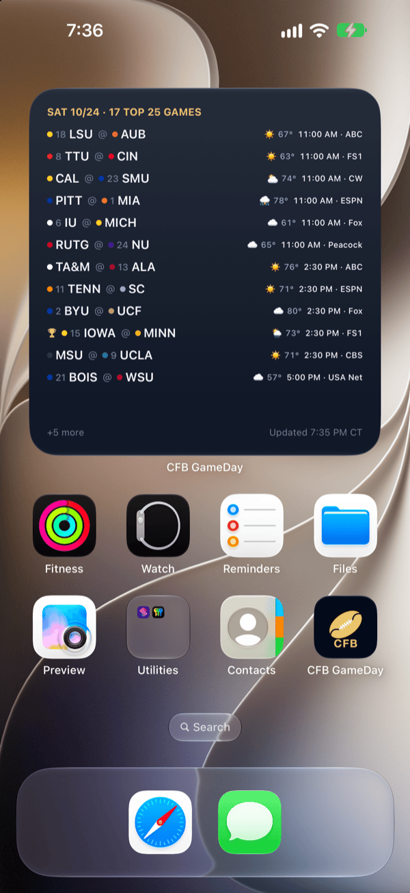
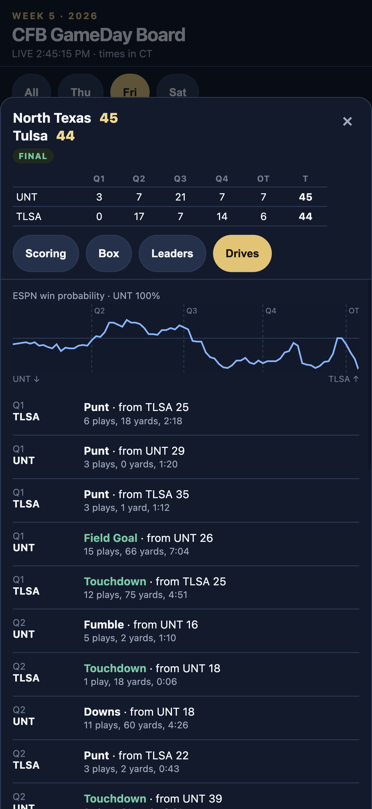

# Christian Verdin

**Data scientist and AI engineer: statistics, data pipelines and LLM systems, measured before they ship.**

I build data products end to end and test them the way I'd want them tested: held-out evaluations for LLM changes, proper scoring rules and calibration checks for models, natural experiments where the data allows one, and null results reported next to the wins. Everything below was built outside work hours, deployed, and kept running, including an iOS app that went through Apple's App Store review.

---

## Projects

| Project | What it does | Status | Stack | Code |
| --- | --- | --- | --- | --- |
| [**College basketball analytics**](#college-basketball-analytics-13-case-studies) | 13 case studies, each answering one question with a number and its uncertainty: an audit that found away favorites given 71% won 61%, Brier scores against KenPom, home court and rest as natural experiments, 41 years of March by simulation, and an MCP text-to-SQL interface scored on held-out questions (9 to 18 of 19, p = 0.004) | **Public** | R · Python · hoopR · MCP | [ncaab-analytics-case-studies](https://github.com/ChristianVerdin/ncaab-analytics-case-studies) · MIT |
| [**312Deals**](#312deals-chicago-food--drink-deals) | Chicago food & drink deals: 75,000+ active deals across 12,000+ venues and 149 neighborhoods from 20,000+ tracked sources, ingested by an LLM extraction pipeline. Agent-first surface: REST API · 11-tool MCP server · 18 WebMCP tools · custom GPT · in-app chat | **Live** | Next.js · FastAPI · SQLite on Cloudflare R2 · MCP | [312deals-webmcp](https://github.com/ChristianVerdin/312deals-webmcp) · MIT (WebMCP Challenge entry) |
| [**CFB GameDay Board**](#cfb-gameday-board-college-football-slate-on-web-and-ios) | Every FBS game on one screen: kickoff-hour stadium weather, TV, and rivalry trophies, then live scores and a game sheet with drives, box score, and win probability. Version 1.1 adds a Today's Games widget and universal links. Stdlib Python, vanilla JS, zero dependencies, SwiftUI app for iPhone, iPad, and Mac | **Live · App Store** | Python · JavaScript · SwiftUI · Vercel | [cfb-gameday-board](https://github.com/ChristianVerdin/cfb-gameday-board) · MIT |
| [**Page Grabber**](#page-grabber-web-capture-pipeline-with-an-mcp-server) | Captures any web page, including JavaScript-built and lazily loaded ones, as clean Markdown into a searchable archive that Claude reads through a 6-tool MCP server. Safari and Chrome extension, Playwright batch CLI, Cloudflare R2 and D1 inbox | Daily use · private | JavaScript · Python · SQLite FTS5 · MCP · Cloudflare | private |
| [**World Cup bracket tracker**](#world-cup-bracket-tracker) | Auto-updating tracker for an AgentMail World Cup 2026 bracket, refreshed twice daily through the tournament. GitHub Actions + AgentMail API, no servers | Complete | Python · GitHub Actions | [worldcup_agentcup-tracker](https://github.com/ChristianVerdin/worldcup_agentcup-tracker) · MIT |

### Where to start reading

- **[ncaab-analytics-case-studies](https://github.com/ChristianVerdin/ncaab-analytics-case-studies)**: statistics first. Its README maps the studies to data science, analytics, AI engineering and management roles. Start with 01 (auditing an inherited model) and 02 (scoring a model's probabilities with proper rules).
- **[312deals-webmcp](https://github.com/ChristianVerdin/312deals-webmcp)**: how a data platform exposes itself to browser-native agents. 17 tools on `document.modelContext`, a "Tonight" planner a person and their agent build together, write-with-consent tips routed to human review. Start at `docs/04-WEBMCP-ARCHITECTURE.md`.
- **[cfb-gameday-board](https://github.com/ChristianVerdin/cfb-gameday-board)**: the cleanest end-to-end example. Zero-dependency Python server and snapshot builder, vanilla JS client, SwiftUI app and WidgetKit widget, scripted App Store Connect release pipeline, self-healing GitHub Action that rebuilds the slate seven times a week. Start at `docs/ARCHITECTURE.md`, then `ios/APP_STORE.md`.

**In progress:** a pre-registered entry for the NFL Big Data Bowl 2027 on Kaggle. The analysis plan was committed before any game-side outcome was computed; results follow the January 2027 deadline.

---

## College basketball analytics: 13 case studies
**Public data, reproducible, every answer with its uncertainty | Public, MIT**

Each study asks one question about men's college basketball, answers it with a number and an interval, and shows the checks behind it. They run on 25 seasons of public ESPN data (about 142,000 games and 2 million player box scores) through one shared data layer and one ratings model that cannot see the future. An audit of last season's model found seven defects, including away favorites given 71% that won 61%, invisible in the season-wide average. The rebuilt model matches KenPom's own game probabilities on Brier score over 5,751 games. Playing the day before costs about 1.5 points (95% CI 0.9 to 2.1), measured as a natural experiment and replicated independently. Close-game records don't carry over from one half-season to the next (r = 0.01, against 0.52 for point margin). An MCP server answers plain-English questions about the season, 18 of 19 correct on held-out questions after tuning on a separate set. A publish check runs before every push: no data files, no licensed ratings, no secrets.

**Source:** [ncaab-analytics-case-studies](https://github.com/ChristianVerdin/ncaab-analytics-case-studies) · `R` `Python` `hoopR` `ridge regression` `bootstrap` `natural experiments` `MCP`

---

## 312Deals: Chicago Food & Drink Deals
**LLM extraction pipeline + agent-first distribution for local commerce**

A production platform aggregating **75,000+ active deals** across **12,000+ venues** and **149 neighborhoods** across Chicagoland, read from **20,000+ tracked sources**. The pipeline runs venue web pages, newsletters, and submissions through LLM extraction with schema validation, content hashing, adaptive scheduling with exponential backoff, and automated 0 to 100 quality scoring, at **under a cent of Claude spend per extracted deal**. Distribution is agent-first: an 18-endpoint REST API, an 11-tool MCP server, 18 in-page WebMCP tools (entered in OpenAI's WebMCP Challenge, Sept 2026), a custom GPT, in-app chat, and a machine-readable `llms.txt` scoring **96/100 on Mintlify's Agent Score**. Programmatic SEO (100+ landing pages) took organic search from an average position of about 24 at launch to page one by June. Since the February 2026 launch: **39,000+ visitors, 9,800+ in the last 28 days**, with no paid traffic. Search Console shows **26,000+ clicks and 2.3M+ impressions at an average position of 7.0**. Traffic figures run through October 27, 2026.

**Live:** [312deals.com](https://312deals.com) · **Public code:** [312deals-webmcp](https://github.com/ChristianVerdin/312deals-webmcp)

  

  

<b>More screenshots</b>

 

Plausible, March 1 to September 17, 2026. Older than the figures above.

Google Search Console, March 1 to mid-September 2026, captured September 17. Older than the figures above.

**What's interesting technically**
- **Agent surface as a first-class product:** the same tool definitions serve the MCP server, the WebMCP registration, and the custom GPT, so a person, a browser agent, and a desktop agent get identical capabilities.
- **Extraction economics:** content hashing and adaptive scheduling turned an LLM-per-page pipeline into something that costs under a cent of Claude spend per extracted deal.
- **Eval before edit:** the extraction prompt has a hand-labeled test set and a held-out set, and changes ship only when they hold on pages the prompt has never seen. That's how a cheaper model got in without a quality loss.
- **Data as a distributed artifact:** SQLite with WAL and FTS5, distributed through Cloudflare R2 with If-Match ETag guards, so the read path never blocks on the write path.
- **Quality loop:** automated 0 to 100 scoring plus a user-driven review queue, and public venue payloads are sanitized through an explicit allow-list.

**Built with:** `Next.js` `TypeScript` `FastAPI` `Python` `SQLite` `Cloudflare R2` `MCP / FastMCP` `WebMCP` `Railway` `Vercel` `Plausible`

---

## CFB GameDay Board: College Football Slate on Web and iOS
**One screen for every FBS Saturday | Live on the web and the App Store for iPhone, iPad, and Mac | Public, MIT**

Venue, kickoff-hour stadium weather, and TV and streaming for every FBS game, then live score, clock, and down and distance once games kick, refreshed every 30 seconds while games run. Tap any live or final game for a game sheet with the scoring summary, box score, leaders, drives, and ESPN win probability. Named rivalries carry their trophy on the card, and a Rivalry filter pulls them together. Built with a deliberately small footprint: a standard-library Python server and snapshot builder, a vanilla JavaScript client with no framework and no build step, and a native SwiftUI app. Built, deployed to the web, and submitted to App Review in a single day. Free, no ads, no account, and Apple's privacy label reads **Data Not Collected**.

**Version 1.1** (on the App Store since October 22, 2026) adds a **Today's Games widget** for the Home Screen and Lock Screen in small, medium, and large sizes, set to all games, the Top 25, or rivalry games. **Universal links** open cfbgameday.app links straight in the app. Long-press the icon for quick actions, including **Rivalry Games**, and six **in-app events** on the App Store cover rivalry Saturdays, Rivalry Week, and the postseason. The same app runs on **iPhone, iPad, and Mac**, where the window resizes.

**Live:** [cfbgameday.app](https://cfbgameday.app) · [App Store](https://apps.apple.com/us/app/cfb-gameday-board/id6809035228) · **Source:** [cfb-gameday-board](https://github.com/ChristianVerdin/cfb-gameday-board) · **Read:** [five-minute case study](https://github.com/ChristianVerdin/cfb-gameday-board/blob/main/docs/CASE_STUDY.md)

  

  
  

**What's interesting technically**
- **Weather at the kick hour:** Open-Meteo forecast for each venue city, with rain, wind, heat, and altitude flags and an impact read per game.
- **A refresh that heals itself:** a GitHub Action rebuilds the slate seven times a week, each run scheduled hours early because GitHub starts scheduled runs late. A run that loses kickoff forecasts retries and heals itself, and it fails loudly only when it can't.
- **One snapshot, every surface:** the site, the app, and the WidgetKit widget all read the same weekly snapshot and live feed, and unit tests render the widget against a frozen week of real games.
- **Release pipeline as code:** archive, export, validate, upload, attach, and submit through the App Store Connect API from one script, and the same pattern is reusable for the next iOS app.

**Built with:** `Python (stdlib)` `JavaScript` `SwiftUI` `WidgetKit` `WKWebView` `Vercel` `GitHub Actions` `Open-Meteo`

---

## Page Grabber: Web Capture Pipeline with an MCP Server
**A tool I use every day | private repository**

Many pages hand a server-side fetch nothing but "Please enable JavaScript": the content is built in the browser and loads as you scroll. Page Grabber captures the full text from inside the browser after the page renders, scrolling for you, following virtualized lists and inner scroll panels, and turning the result into clean Markdown. One capture engine is shared by a Safari and Chrome extension, a Playwright command-line tool for batches of URLs, and the test suite. Captures land in a local archive with SQLite FTS5 search, a Cloudflare Worker (R2 storage, D1 index) takes captures from other devices, and a 6-tool MCP server lets Claude search, read and annotate the archive. SwiftUI apps for iPhone, iPad and Mac build in the simulator and have not been submitted to the App Store yet.

**Stack:** `JavaScript (MV3 extension)` `Python (stdlib)` `SQLite FTS5` `MCP` `Cloudflare Workers, R2, D1` `Playwright` `SwiftUI`. About 310 automated checks across four suites. Private repository.

---

## World Cup bracket tracker
**Scheduled agent automation with no servers**

An auto-updating tracker for an AgentMail World Cup 2026 bracket: twice a day through the tournament, a GitHub Action pulled results through the AgentMail API, recomputed standings, and committed the refreshed page. Small on purpose: a compact, readable example of cron-style agent automation that runs entirely on GitHub infrastructure.

**Source:** [worldcup_agentcup-tracker](https://github.com/ChristianVerdin/worldcup_agentcup-tracker) · `Python` `GitHub Actions` `AgentMail`

**Earlier projects:** [LakeshoreIQ](https://lakeshoreiq.com), Illinois property search and neighborhood data built on public sources.

---

## How I build

- **Production first.** Every flagship project has real users or a real platform review behind it. A demo is the starting line.
- **Measure before optimizing.** I build the tracing and evaluation layer first and let the evidence pick the re-architecture.
- **Safety as architecture.** Least-privilege access, publish checks and rollback paths are design inputs, not afterthoughts.
- **Agent-first surfaces.** Anything I build for people also gets an MCP or WebMCP surface so other agents can use it.
- **Documentation that survives handoff.** Every repo carries a `CLAUDE.md`/`CONTEXT.md` with verified state, constraints, and gotchas, written for the next engineer and for AI coding agents alike.

---

## Technical skills

**Statistics:** calibration and proper scoring rules (Brier, log loss, reliability diagrams), walk-forward and held-out evaluation, bootstrap intervals, McNemar, permutation and Holm-corrected tests, natural experiments and fixed effects, ridge regression, Monte Carlo simulation, pre-registration

**Machine learning:** LightGBM, XGBoost, isotonic calibration, clustering with stability checks, NLP and LLM extraction

**LLM systems:** Claude API, prompt caching, eval harnesses with labeled and held-out sets, cost metering from reported usage, MCP and WebMCP servers, text-to-SQL, multi-agent work with guardrails

**Data & engineering:** Python, R, SQL, TypeScript/JavaScript, Swift/SwiftUI · SQLite/FTS5, PostgreSQL · FastAPI, Next.js · Cloudflare (Workers, R2, D1), Vercel, Railway, GitHub Actions, Playwright · App Store release and review

---

## Let's connect

Always open to collaborating and/or connecting. Chicago-based, remote or relocation welcome.

  <a href="https://www.linkedin.com/in/christian-verdin/">LinkedIn</a> · <a href="mailto:christiandverdin@gmail.com">christiandverdin@gmail.com</a>

